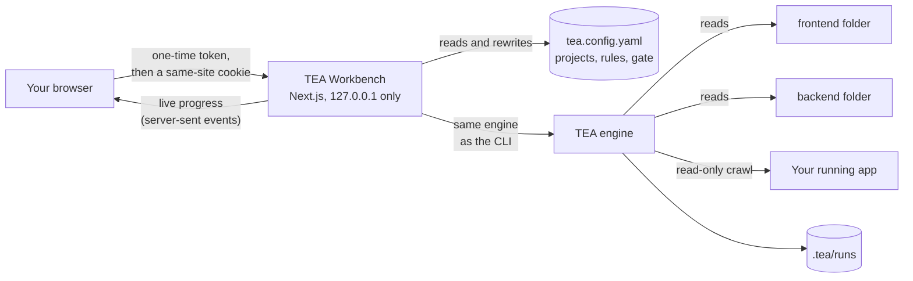
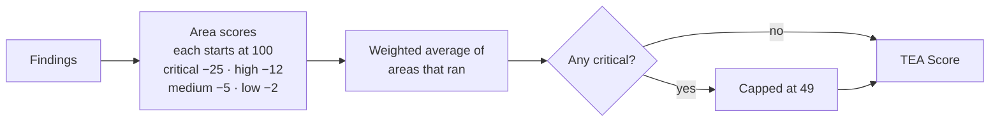
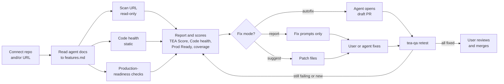
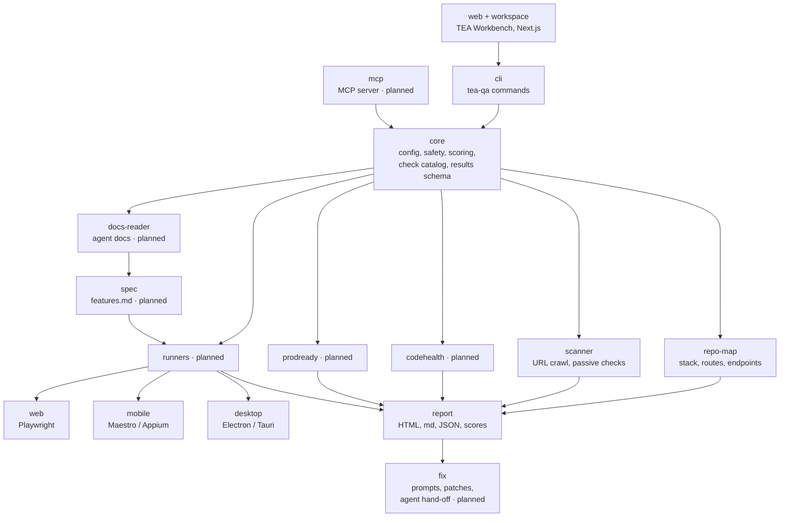
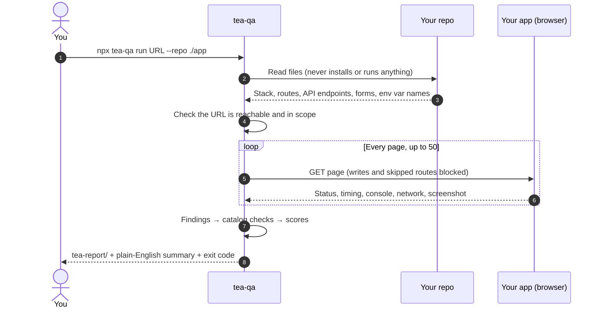
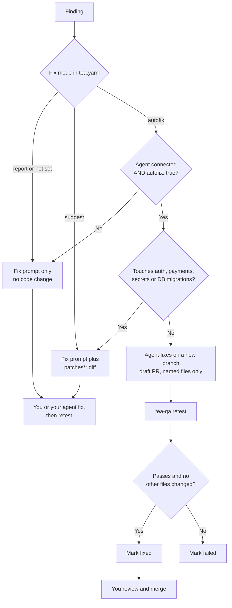
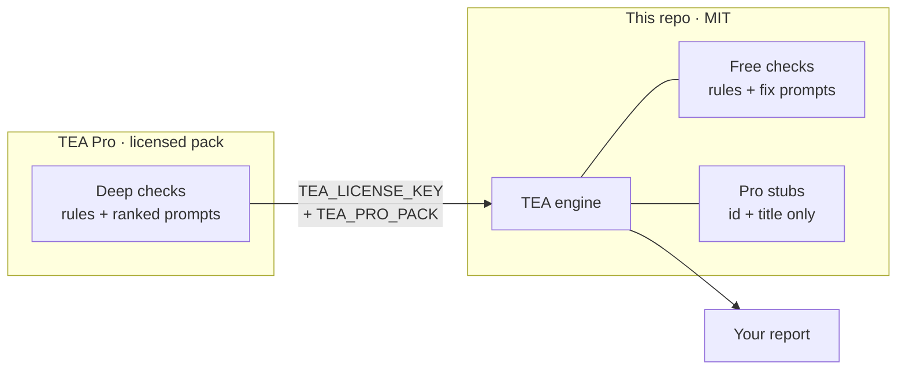
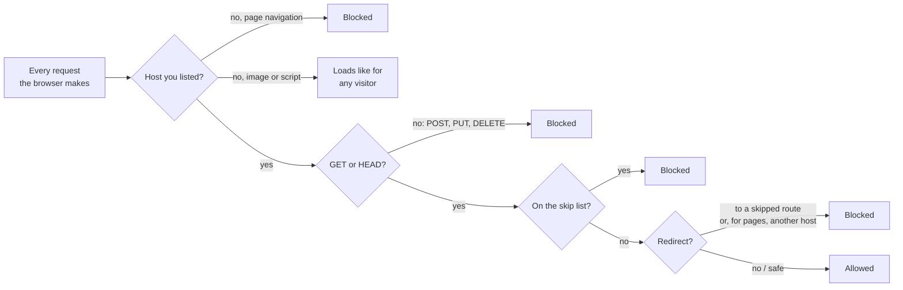

<p align="center">
  
</p>

<p align="center">
  <a href="https://github.com/deepbratt/TEA/actions/workflows/ci.yml"></a>
  <a href="LICENSE"></a>
  
  
  
  <a href="CONTRIBUTING.md"></a>
</p>

<p align="center"><b>The free, open-source QA tester for vibe-coded apps.</b><br>
Point it at your app's folder and URL. Get one plain-English report, a quality gate, and fix prompts your AI coding agent can use. Fix, retest, ship.</p>

<p align="center">
  <a href="#-quick-start">Quick start</a> ·
  <a href="#%EF%B8%8F-the-tea-workbench">Workbench</a> ·
  <a href="#-works-with-any-stack">Any stack</a> ·
  <a href="#-use-it-in-ci">CI</a> ·
  <a href="#%EF%B8%8F-roadmap">Roadmap</a> ·
  <a href="CONTRIBUTING.md">Contributing</a>
</p>

---

You built your app with Lovable, Bolt, v0, Replit, Cursor, Windsurf or Claude Code. It *looks* finished. But has anyone checked that the paywall loads, the password reset works, user A can't read user B's data, and no secret key is sitting in your JavaScript bundle?

**TEA checks.** It reads the docs your AI agents wrote, tests every feature, checks code health and production readiness, and writes one report with a **TEA Score**, a top-10 list in plain English, and a fix prompt for every issue. After you (or your agent) fix things, `tea-qa retest` proves they're fixed.

<p align="center">
  
</p>

> [!NOTE]
> **Status: beta.** Working today:
> - **Discovery with zero config:** your stack, pages, API endpoints and API calls, in [12 languages](#-works-with-any-stack).
> - **Live testing:** a read-only crawl of your running app.
> - **Wiring checks:** every frontend call is matched to a backend endpoint.
> - **The TEA Workbench:** projects, issues, rules and a quality gate.
> - **Reports:** HTML, Markdown and JSON, with a TEA Score and a fix prompt for every issue.
>
> Features marked *planned* are on the [roadmap](#%EF%B8%8F-roadmap). Live status: [BUILD-PROGRESS.md](BUILD-PROGRESS.md).

<details>
<summary><b>Contents</b></summary>

- [Quick start](#-quick-start)
- [The TEA Workbench](#%EF%B8%8F-the-tea-workbench)
- [What you get](#-what-you-get)
- [How it works](#-how-it-works)
- [Works with any stack](#-works-with-any-stack)
- [Use it in CI](#-use-it-in-ci)
- [features.md: claimed vs reality](#-featuresmd-claimed-vs-reality)
- [Fix modes](#%EF%B8%8F-fix-modes)
- [Checks are data](#-checks-are-data)
- [tea.yaml](#%EF%B8%8F-teayaml-optional)
- [Responsible use](#%EF%B8%8F-responsible-use)
- [Roadmap](#%EF%B8%8F-roadmap)
- [Writing a plugin](#-writing-a-plugin)
- [Development](#-development)
- [Contributing](#-contributing)
- [Author](#-author)
- [License](#-license)

</details>

## ⚡ Quick start

**Requirements:** Node.js 20.9 or newer, and git. Windows, macOS and Linux all work.

```bash
git clone https://github.com/deepbratt/TEA.git
cd TEA
npm start
```

`npm start` does everything:
1. It installs dependencies, with install scripts disabled for supply-chain safety.
2. It builds TEA and the Workbench, and rebuilds only what changed on later runs.
3. It downloads a headless Chromium the first time.
4. It opens the **TEA Workbench** in your browser.

The first start takes a few minutes; later starts take seconds.

Then, in the Workbench:

1. **Add project → Choose folder and detect.** Pick your app's folder. TEA finds the apps in it, their languages and frameworks, and whether each is a frontend, backend or fullstack app.
2. **Start your app** the way you normally do, and pick its address from TEA's suggestions (it shows which one is running).
3. **Run analysis.** Watch it live, then go through the issues, copy a fix prompt into your AI coding tool, fix, and run again.

> [!TIP]
> Want to see it first? `npm run demo` runs TEA against a bundled example app full of planted bugs and opens the report. `npm start -- --port 5000 --workspace ../my-app/tea.config.yaml` changes the port or config file.

<details>
<summary><b>Prefer the command line?</b></summary>

TEA isn't published to npm yet. From a clone, use `node dist/cli/bin.js` (after `npm start` or `npm run build`) wherever you see `npx tea-qa` below.

```bash
# 1. Test a live app (read-only)
npx tea-qa run https://your-app.com

# 2. Better: give TEA the code too, so every issue points to a file and line
npx tea-qa run https://your-app.com --repo ./your-app

# 3. A separate frontend and backend (roles auto-detected)
npx tea-qa run http://localhost:3000 --source ../web --source ../api

# 4. Code only: TEA asks before starting your app with its own dev script
npx tea-qa run ./your-app

# See the plan and estimated cost first. Nothing is opened or changed.
npx tea-qa run https://your-app.com --repo ./your-app --dry-run
```

Then open `tea-report/report.html`. The [full list of options](#%EF%B8%8F-teayaml-optional) is below.

</details>

## 🖥️ The TEA Workbench

Prefer clicking to typing? `npm start` (from source) or `npx tea-qa ui` opens the **TEA Workbench**, a local web app (Next.js, on your own computer) that works like SonarQube for vibe-coded apps: projects, analyses, issues, rules and a quality gate.

```bash
npx tea-qa ui          # opens http://127.0.0.1:4747 in your browser
```

- **Projects.** Add your app once: choose its folder and TEA detects the apps in it, their languages and frameworks, whether each is a frontend, backend or fullstack app, and the local URL where it runs. A separate frontend and backend repo? Add both folders (up to 10).
- **Analyses.** Press **Run analysis** and watch TEA work live. Every analysis is kept, with its full report.
- **Issues.** Every finding, filterable by severity, area and check, with steps to see it and a fix prompt to paste into your AI coding tool.
- **Frontend-to-API wiring.** TEA reads every `fetch`/`axios` call and form in the frontend and every route in the backend. A call nothing serves (or with a method the route doesn't handle) is an issue; an endpoint nothing calls is a suggestion.
- **Rules.** Turn checks on or off, change their severity, tune thresholds (for example what counts as a slow page).
- **Quality gate.** Conditions like *critical issues > 0* or *TEA Score < 60*. Each analysis is marked **Passed** or **Failed**, and `tea-qa run --project <key>` exits with an error when the gate fails, so CI can block a bad deploy.



### One config file

Everything you set in the Workbench lives in one file, `tea.config.yaml`, next to where you ran `tea-qa ui` (or `--workspace <file>`). Edit it in the Workbench (on the page or as text) or in your editor, and commit it with your code. Saving from the Workbench validates it first and keeps your comments.

```yaml
version: 1
projects:
  - key: shop
    name: My shop
    url: http://localhost:3000        # optional: where the app runs
    sources:
      - { name: web, path: ../shop-web, role: frontend }
      - { name: api, path: ../shop-api }   # role: auto (default) lets TEA decide
rules:
  crawl.slow: { params: { thresholdMs: 2000 } }
  wiring.unused-endpoint: { enabled: false }
gate:
  conditions:
    - { metric: critical, op: gt, value: 0 }
    - { metric: high, op: gt, value: 3 }
    - { metric: score, op: lt, value: 60 }
```

Run the same project from the command line or CI, with its rules and gate:

```bash
npx tea-qa run --project shop                 # uses ./tea.config.yaml
npx tea-qa run --source ../web --source ../api   # no config file; roles auto-detected
```

**Safe by design.** The Workbench only listens on your own computer, needs the one-time link TEA prints, refuses requests addressed to other host names (DNS rebinding) and writes from other websites, so a page you have open elsewhere can't start an analysis or read your results. It never installs packages or starts your app: give it the URL where your app already runs to test it live; without a URL it reads the code only. Analyses are stored in `.tea/runs/` next to the config file; add `.tea/` to your `.gitignore`.

<!-- Demo GIF placeholder: a 20-second recording of `npx tea-qa run` and the report opening. -->
<!-- <p align="center"></p> -->

## ☕ What you get

<table>
<tr>
<td width="55%" valign="top">

```text
Here's the TEA on your app: 68/100 (Lukewarm).
TEA opened 10 pages in your running app and read
your code (Next.js, React). It found 8 issues:
2 high, 4 medium, 2 low.

Top issues:
 1. [high] API call fails on /pricing:
    GET /api/plans (500)  app/api/plans/route.ts
 2. [high] Page crashes with a server error
    (500): /account  app/account/page.tsx
 3. [medium] JavaScript crashes on /about
 4. [medium] Broken link to /blog
 5. [medium] Broken link to /terms
```

A real run against [`examples/buggy-next-app`](examples/buggy-next-app), a made-up tea shop full of seeded bugs (`npm run demo` reproduces it). Issue 1 is the classic launch bug: the pricing page loads, but shows no plans, so nobody can pay.

</td>
<td width="45%" valign="top">

<sub>A sample score card (shareable PNG export is planned).</sub>
</td>
</tr>
</table>

Every finding comes with a severity, evidence (a screenshot or URL), the likely `file:line`, steps to reproduce, and a **fix prompt** you can paste into Cursor, Claude or Lovable. Anything TEA observed on your site is quoted inside an `UNTRUSTED EVIDENCE` block, so your agent never follows instructions hidden in page text.

| In `tea-report/` | What it is |
|---|---|
| `report.html` | The report: TEA Score, area scores, top fixes with screenshots and copy-paste fix prompts, feature map |
| `report.md` | The same report in Markdown, for PRs and issues |
| `results.json` | Machine-readable results |
| `app-map.json` · `feature-map.md` | Your stack, pages, API endpoints, forms, auth, payments and env var *names*, plus what's live, what's broken and what nothing links to |
| `screenshots/` | A full-page screenshot of every page TEA visited |

### The TEA Score



| Score | Verdict |
|---|---|
| 90–100 | ☕ Piping hot |
| 75–89 | 🍵 A good brew |
| 50–74 | 🫖 Lukewarm |
| 0–49 | 💦 Spilled |

Areas that didn't run show "not run yet" and don't count. The full set of sub-scores (features, security, performance, accessibility, code health, Prod Ready, UI wiring, DB scale) arrives with the steps that measure them.

## 🔍 How it works



<details>
<summary><b>Code map</b> (one package, one folder per part under <code>src/</code>)</summary>



</details>

<details>
<summary><b>What happens during a run</b></summary>



</details>

## 📜 features.md: claimed vs reality

*Planned (step 4).* TEA reads the docs your AI agents wrote **before** the code: `AGENTS.md`, `CLAUDE.md`, `GEMINI.md`, `.cursorrules`, `.cursor/rules/*`, `.windsurfrules`, `replit.md`, `.lovable/`, `.bolt/`, README, PRD/SPEC/TODO/CHANGELOG and `docs/`. It turns every claimed feature into a Given/When/Then check linked to its source line, and labels it *found in code*, *claimed but missing* or *built but undocumented*. You review it once (about 2 minutes); after that it is the source of truth.

```markdown
## CSV export
- Given a signed-in user with orders
- When they click "Export CSV" on /orders
- Then a CSV with one row per order downloads
- Source: CLAUDE.md:42 · Status: claimed but missing
```

Docs are untrusted data: TEA never follows instructions in them, and secrets found in docs are reported as leaked (and masked).

## 🛠️ Fix modes

*Planned (steps 8, 11, 12).* Set per repo in `tea.yaml`.



| Mode | What TEA does |
|---|---|
| `report` (default) | Report, scores and copy-paste fix prompts. Changes no code. |
| `suggest` | Everything in `report`, plus patch files in `tea-report/patches/*.diff` for you to apply. |
| `autofix` | Hands each finding to a connected agent (Claude, Cursor, GitLab Duo or any MCP client), which opens a **draft PR** touching only the files the finding names. TEA retests and marks it fixed or failed. |

TEA never merges and never pushes to main. Findings that touch auth, payments, secrets or database migrations always stay suggest-only.

## 🧩 Checks are data

Every check is a catalog entry, not hard-coded logic, so checks can be added, ranked and updated without a TEA upgrade.

```yaml
# checks/functional/crawl.server-error.yaml
id: crawl.server-error
title: Page crashes with a server error (5xx)
category: functional
severity: high
detect: crawl
rule: scanner:crawl.server-error
fix_prompt: prompts/crawl/server-error.md   # template with {file}, {route}, {evidence}
suggest_only: false
pack: free
version: 1
```



All **free** checks live here with their rules and prompts, and anyone can contribute new ones ([how](CONTRIBUTING.md#adding-a-check)). **TEA Pro** adds deeper checks (multi-role IDOR probes, race conditions, Supabase RLS correctness, Stripe edge cases, database-at-scale proofs, AI cost and abuse). In this repo they exist only as stubs with an id and a title, so a free report can tell you what a deeper check would cover. The loader refuses any pro rule written into the public catalog.

## 🌍 Works with any stack

A generic core works on any live URL and any repo, in any language. TEA reads each ecosystem's manifest (`package.json`, `requirements.txt`, `pyproject.toml`, `Pipfile`, `go.mod`, `Cargo.toml`, `pom.xml`, `build.gradle`, `*.csproj`, `composer.json`, `Gemfile`, `mix.exs`, `pubspec.yaml`, `Package.swift`). Stack knowledge lives in plugins that switch on automatically when TEA detects the stack.

| | Detected today | Routes and endpoints read from code |
|---|---|---|
| **JavaScript / TypeScript** | Next.js, Remix / React Router 7, Nuxt, SvelteKit, Astro, Angular, React, Vue, Svelte, Solid, Qwik, Preact, Gatsby, Ember, htmx, Vite | Express, NestJS, Fastify, Hono, Koa, Elysia, plus every meta-framework |
| **Python** | FastAPI, Flask, Django, Starlette, Sanic, Litestar, Quart | ✓ |
| **Go** | net/http, Gin, Echo, Fiber, chi, Gorilla mux | ✓ (route groups too) |
| **Rust** | Axum, Actix Web, Rocket | ✓ |
| **Java / Kotlin** | Spring Boot, JAX-RS / Quarkus, Micronaut, Ktor | ✓ |
| **C# / .NET** | ASP.NET Core (minimal APIs and controllers), Blazor | ✓ |
| **PHP** | Laravel, Symfony, Slim | ✓ |
| **Ruby, Elixir, Swift** | Rails, Sinatra, Phoenix, Vapor | ✓ |
| **Mobile and desktop** | Expo, React Native, Flutter, iOS (Swift), Android, Capacitor, Ionic, Electron, Tauri | API calls (runners planned) |
| **Data and auth** | Supabase, Firebase, Prisma, Drizzle, SQLAlchemy, GORM, Diesel / SeaORM / SQLx, Entity Framework, JPA, Ecto, MongoDB, Postgres, MySQL, SQLite, Redis, Convex, NextAuth, Clerk, Auth0, Better Auth, Devise | |
| **Payments** | Stripe, RevenueCat, Lemon Squeezy, Paddle | |
| **Built with** | Lovable, Bolt, v0, Replit, Cursor, Windsurf, Claude Code | |

**API calls in any client language** feed the frontend-to-API wiring checks: `fetch`/`axios`/`useSWR`/Angular `HttpClient` (JS/TS), `requests`/`httpx` (Python), `net/http` (Go), `reqwest` (Rust), Retrofit/OkHttp/Ktor client/RestTemplate (JVM), `HttpClient` (C#), Laravel `Http`/Guzzle (PHP), Faraday/HTTParty (Ruby), `http`/Dio (Dart), `URLSession` (Swift). Calls to other hosts (Stripe, OpenAI…) are left out.

**Auto-detect.** Point TEA at a folder and it works out the rest:
- **One app or many.** A monorepo (npm/pnpm workspaces, Turborepo, Nx, `go.work`, or just `frontend/` + `backend/` folders) is split into its apps.
- **Frontend, backend or fullstack.** Each folder's role is decided from what's in it (`role: auto`, the default), so a React app and a Go API are wired together without any setup.
- **Where it runs.** TEA suggests the local URL from the app's own config or its framework's dev port, and checks which one is running right now.

Unknown stack? TEA still crawls the live site, and falls back to the links it finds in your source.

## ⚙️ tea.yaml (optional)

TEA needs no config. Add a `tea.yaml` only to change the defaults (full example: [`tea.example.yaml`](tea.example.yaml)).

```yaml
urls:
  - https://staging.your-app.com
skip:
  - /admin/**
  - /logout
allowlist:
  - api.your-app.com
accounts:
  - role: user
    email: tea-user@your-app.com
    password: ${TEA_USER_PASSWORD}   # read from the environment, masked everywhere
crawl:
  maxPages: 100
  slowPageMs: 3000
failOn: high
```

> [!TIP]
> A `tea.yaml` that TEA finds by itself inside the folder it's testing is treated as untrusted. Only its skip list, accounts and *lower* limits apply. Pass it with `--config tea.yaml` (or add `--trust-repo-config`) when it's yours. `${NAME}` works only in account fields, and only for `TEA_*` variables.

<details>
<summary><b>All options</b></summary>

```text
npx tea-qa run [url-or-folder] [options]

  --url <url>               URL of the running app to test
  --repo <path>             folder with the app source code
  --source <[role=]path>    a code folder; repeat for a separate frontend and backend (role auto-detected, or frontend=, backend=, fullstack=)
  --project <key>           run a project from tea.config.yaml, with its rules and quality gate (exit 1 if the gate fails)
  -w, --workspace <file>    the config file for --project (default: tea.config.yaml)
  -o, --out <dir>           where to write the report (default: tea-report)
  -c, --config <file>       tea.yaml to use (trusted)
  --max-pages <n>           most pages to visit (default: 50)
  --fail-on <severity>      exit 1 at this severity or worse: critical (default), high, medium, low, none
  --skip <glob>             route to never visit, e.g. "/admin/**" (repeatable)
  --allow <host>            extra host TEA may visit (repeatable)
  --login <email:password>  test account to use (masked everywhere)
  --start / --no-start      code-only: start the app without asking / never start it
  --trust-repo-config       trust a tea.yaml found in the tested folder (urls, allowlist, plugins)
  --no-ai                   rules only, no LLM calls
  --no-screenshots          do not save page screenshots
  --dry-run                 show the plan and estimated cost without doing anything
  -v, --verbose / -q, --quiet
```

`tea` is a short alias for `tea-qa`. `tea-qa ui [--workspace tea.config.yaml] [--port 4747] [--no-open]` opens the TEA Workbench. Planned commands: `tea-qa retest`, `tea-qa mcp`, and `tea-qa run --targets targets.yaml` for many apps at once.

</details>

## 🛡️ Responsible use

**Only test apps you own or are authorised to test.** TEA shows this notice the first time it runs.



- **Read-only against live URLs.** TEA opens pages and never submits forms, logs in or sends write requests, even from your page's own scripts. Forms, logins and writes will only run in a sandbox you set up (step 10).
- **No load tests, active scans or fuzzing against production.**
- **Your repo is untrusted input.** TEA never runs `npm install` (install scripts are how supply-chain malware gets in), asks before starting your app, refuses dev scripts that look like they download or evaluate code, and ignores plugins and targets from a `tea.yaml` it wasn't given.
- **Docs and page content never change what TEA does.**
- **Secrets are masked everywhere:** the terminal, the report and every JSON file. TEA records env var *names*, never values.
- **Cost guard.** `--dry-run` shows the plan and estimated cost first. This version makes no LLM calls, so it costs $0.

> [!WARNING]
> **Badge disclaimer:** The TEA checked badge is not a security guarantee, audit or certification. It only shows the score from TEA's automated tests at the date of the last run.

## 🗺️ Roadmap

```mermaid
flowchart LR
    S1[1 Skeleton<br/>and hygiene]:::doing --> S2[2 Buggy<br/>example app]:::part --> S3[3 URL scan]:::part --> S4[4 Docs reader<br/>features.md] --> S5[5 Code health]
    S5 --> S6[6 Prod<br/>readiness] --> S7[7 Report<br/>and score]:::part --> S8[8 Fix prompts] --> S9[9 Retest] --> S10[10 AI functional<br/>tester]
    S10 --> S11[11 MCP server] --> S12[12 GitHub Action<br/>GitLab CI] --> S13[13 Mobile and<br/>desktop runners] --> S14[14 AI design<br/>review]
    classDef doing fill:#f05d61,stroke:#b3262c,color:#141517
    classDef part fill:#c9ccd1,stroke:#5c5f66,color:#141517
```



<sub>Red: in progress · grey: partly built · outlined: planned. Live status: [BUILD-PROGRESS.md](BUILD-PROGRESS.md).</sub>

| Step | What it adds |
|---|---|
| 3 · URL scan | Security headers, cookies, HTTPS/TLS, secrets in JS bundles and source maps, exposed endpoints, Supabase/Firebase client config, Lighthouse and axe |
| 4 · Docs reader | `features.md`: claimed vs reality from your agent docs |
| 5 · Code health | Duplication, circular imports, dead code, complexity, committed `.env`, leftover `console.log`, mock data in production → `CODE-HEALTH.md` |
| 6 · Prod readiness | Auth on every route, rate limits, input validation, CORS, CSP/HSTS, error handling, health checks, migrations, indexes, Stripe webhook signatures, privacy/terms, account deletion → **Prod Ready** score |
| 8–9 · Fix + retest | `FIXES.md`, one `FIX-PROMPT.md` per finding, patch files, and before/after scores |
| 10 · AI tester | Generated Playwright tests per feature in a sandbox: happy path, edge cases, IDOR between two test accounts, persistence; saved to `tea-tests/` |
| 11–12 · MCP + CI | `tea-qa mcp` for Claude Code, Cursor, Windsurf, Copilot and Codex; a GitHub Action that comments "☕ TEA Report" on PRs and runs nightly |
| 13–14 | Mobile (Expo/React Native) and desktop (Electron/Tauri) runners with app-store readiness; AI design review |

Every LLM step will be optional and pluggable (OpenAI, Anthropic, Gemini, or local Ollama for $0).

## 🔌 Writing a plugin

A plugin adds knowledge about one stack, and switches on when that stack is detected:

```ts
import { definePlugin } from 'tea-qa';

export default definePlugin({
  name: 'my-framework',
  activatesOn: ['my-framework'], // or a detect(ctx) function
  async discover(ctx) {
    const routes = ctx.find((f) => f.startsWith('routes/')).map((file) => ({
      path: '/' + file.slice('routes/'.length).replace(/\.ts$/, ''),
      kind: 'page' as const, file, dynamic: false, source: 'code' as const,
    }));
    return { routes };
  },
});
```

List it under `plugins:` in a `tea.yaml` you pass with `--config`.

## 🚦 Use it in CI

Commit `tea.config.yaml`, then fail the build when the quality gate fails:

```yaml
# .github/workflows/tea.yml
name: TEA
on: [pull_request]
jobs:
  tea:
    runs-on: ubuntu-latest
    steps:
      - uses: actions/checkout@v4
      - uses: actions/setup-node@v4
        with: { node-version: 22 }
      - run: git clone --depth 1 https://github.com/deepbratt/TEA.git ../tea && cd ../tea && npm ci && npm run build && npx playwright install --with-deps chromium
      - run: node ../tea/dist/cli/bin.js run --project my-app   # exits 1 when the gate fails
      - uses: actions/upload-artifact@v4
        if: always()
        with: { name: tea-report, path: tea-report }
```

A ready-made GitHub Action that comments "☕ TEA Report" on pull requests is planned (step 12).

## 🧑‍💻 Development

```bash
npm install && npm run build   # engine
npm test                       # unit tests (Node 22+)
npm run lint && npm run typecheck && npm run knip
npm run ui:dev                 # Workbench with hot reload on 127.0.0.1:4747
npm run demo                   # end to end against the example app
node scripts/workbench-e2e.mjs # Workbench in a real browser, with axe in light and dark mode
```

The layout, the rules for new checks and plugins, and the PR checklist are in [CONTRIBUTING.md](CONTRIBUTING.md).

## 🤝 Contributing

New checks, stack plugins and better fix prompts are the most useful contributions. Start with [CONTRIBUTING.md](CONTRIBUTING.md) and the [code of conduct](CODE_OF_CONDUCT.md); open an issue with one of the [templates](https://github.com/deepbratt/TEA/issues/new/choose). What changed in each release is in [CHANGELOG.md](CHANGELOG.md). Found a security problem? Please report it privately; see [SECURITY.md](SECURITY.md).

## 👤 Author

**DeepBratt**: creator and maintainer · [github.com/deepbratt](https://github.com/deepbratt)

If TEA helped you ship, a ⭐ on the repo helps others find it.

## 📄 License

[MIT](LICENSE) © 2026 DeepBratt and TEA contributors. The engine and all free checks are free forever.

<p align="center"><sub>☕ Made by <a href="https://github.com/deepbratt">DeepBratt</a> for everyone who shipped something with AI and wants to know if it really works.</sub></p>
