<p align="center">
  
</p>

<p align="center">
  <a href="LICENSE"></a>
  
  
  <a href="CONTRIBUTING.md"></a>
</p>

<p align="center"><b>The free, open-source QA tester for vibe-coded apps.</b><br>
Point it at your URL and/or repo. Get one plain-English report, with fix prompts your AI coding agent can use. Fix, retest, ship.</p>

---

You built your app with Lovable, Bolt, v0, Replit, Cursor, Windsurf or Claude Code. It *looks* finished. But has anyone checked that the paywall loads, the password reset works, user A can't read user B's data, and no secret key is sitting in your JavaScript bundle?

**TEA checks.** It reads the docs your AI agents wrote, tests every feature, checks code health and production readiness, and writes one report with a **TEA Score**, a top-10 list in plain English, and a fix prompt for every issue. After you (or your agent) fix things, `tea-qa retest` proves they're fixed.

<p align="center">
  
</p>

> [!NOTE]
> **TEA is in early build: step 1 of 14** ([progress](BUILD-PROGRESS.md)). Working today: zero-config discovery of your stack, routes and API endpoints; a read-only crawl of your live app; the HTML/Markdown/JSON report with a TEA Score; and the check catalog. Everything marked *planned* below is on the [roadmap](#-roadmap).

## Contents

- [Quick start](#-quick-start-2-minutes) · [The TEA UI](#%EF%B8%8F-the-tea-ui) · [What you get](#-what-you-get) · [How it works](#-how-it-works) · [features.md](#-featuresmd-claimed-vs-reality) · [Fix modes](#-fix-modes) · [Checks are data](#-checks-are-data) · [Any stack](#-works-with-any-stack) · [tea.yaml](#-teayaml-optional) · [Responsible use](#-responsible-use) · [Roadmap](#-roadmap) · [Plugins](#-writing-a-plugin) · [Contributing](#-contributing)

## ⚡ Quick start (2 minutes)

You need Node.js 20 or newer.

> [!IMPORTANT]
> TEA is not on npm yet. Until the first release, run it from source:
>
> ```bash
> git clone https://github.com/deepbratt/TEA.git && cd TEA
> npm run demo                       # one command: installs, builds, tests the example app, shows the report
> npm start -- https://your-app.com  # then test your own app (same options as `npx tea-qa run`)
> npm run ui                         # or do it all from the local web UI
> ```

```bash
# 1. Test a live app (read-only)
npx tea-qa run https://your-app.com

# 2. Better: give TEA the code too, so every issue points to a file and line
npx tea-qa run https://your-app.com --repo ./your-app

# 3. Code only: TEA asks before starting your app with its own dev script
npx tea-qa run ./your-app

# See the plan and estimated cost first. Nothing is opened or changed.
npx tea-qa run https://your-app.com --repo ./your-app --dry-run
```

Then open `tea-report/report.html`. The first run downloads a headless Chromium; if it doesn't, run `npx playwright install chromium`.

## 🖥️ The TEA UI

Prefer clicking to typing? `npx tea-qa ui` opens a local web app that does everything the CLI does:

```bash
npx tea-qa ui          # opens http://127.0.0.1:4747 in your browser
```

- Enter your app's live URL and pick where the code is:
  - **📁 Folder on this computer:** type a path or click **Browse…** to choose it.
  - **🐙 GitHub repo:** connect GitHub, search your repos, pick a branch. TEA makes a shallow, read-only copy (it never writes to GitHub) and suggests live URLs from the repo's homepage and recent deployments (for example Vercel previews).
- Press **☕ Spill the TEA**.
- Watch TEA work live: every page it visits and every step it takes.
- Get the score, the counts by severity and the full report (with copy-paste fix prompts) right in the page.
- Every run is kept under `tea-report/runs/`, so you can reopen past runs and compare before and after a fix.

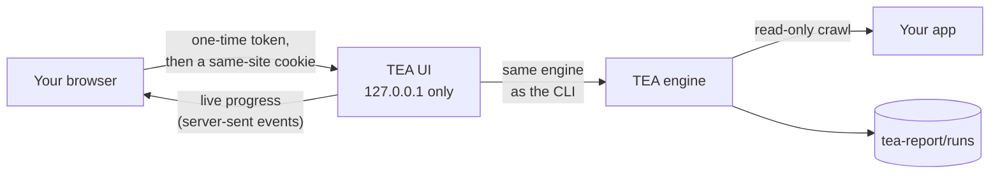

The UI only listens on your own computer, needs the one-time link TEA prints, and refuses requests from other websites, so a page you have open elsewhere can't start a run or read your results. Starting your app from its dev script is a checkbox that's off by default.

**Connecting GitHub.** Three ways, all kept in memory only (never saved to disk) and masked everywhere:

| Option | What you need |
|---|---|
| **Use my GitHub CLI login** | [`gh`](https://cli.github.com) installed and signed in (`gh auth login`). Zero setup. |
| **Sign in with GitHub** | A GitHub OAuth App with *device flow* enabled; set its client id as `TEA_GITHUB_CLIENT_ID` before `tea-qa ui`. You enter a short code on github.com. |
| **Paste a token** | A [fine-grained token](https://github.com/settings/personal-access-tokens/new) with read-only **Contents** and **Metadata** on the repos you want to test. |

A repo cloned from GitHub has no installed dependencies, and TEA never installs them, so give TEA your app's live (or preview) URL to test it running; the code then points every issue at its file.

<!-- Demo GIF placeholder: a 20-second recording of `npx tea-qa run` and the report opening. -->
<!-- <p align="center"></p> -->

## ☕ What you get

<table>
<tr>
<td width="55%" valign="top">

```text
Here's the TEA on your app: 68/100 (Lukewarm).
TEA opened 10 pages in your running app and read
your code (Next.js, React). It found 8 issues:
2 high, 4 medium, 2 low.

Top issues:
 1. [high] API call fails on /pricing:
    GET /api/plans (500)  app/api/plans/route.ts
 2. [high] Page crashes with a server error
    (500): /account  app/account/page.tsx
 3. [medium] JavaScript crashes on /about
 4. [medium] Broken link to /blog
 5. [medium] Broken link to /terms
```

A real run against [`examples/buggy-next-app`](examples/buggy-next-app), a made-up tea shop full of seeded bugs (`npm run demo` reproduces it). Issue 1 is the classic launch bug: the pricing page loads, but shows no plans, so nobody can pay.

</td>
<td width="45%" valign="top">
<sub>A sample score card (shareable PNG export is planned).</sub>
</td>
</tr>
</table>

Every finding comes with a severity, evidence (a screenshot or URL), the likely `file:line`, steps to reproduce, and a **fix prompt** you can paste into Cursor, Claude or Lovable. Anything TEA observed on your site is quoted inside an `UNTRUSTED EVIDENCE` block, so your agent never follows instructions hidden in page text.

| In `tea-report/` | What it is |
|---|---|
| `report.html` | The report: TEA Score, area scores, top fixes with screenshots and copy-paste fix prompts, feature map |
| `report.md` | The same report in Markdown, for PRs and issues |
| `results.json` | Machine-readable results |
| `app-map.json` · `feature-map.md` | Your stack, pages, API endpoints, forms, auth, payments and env var *names*, plus what's live, what's broken and what nothing links to |
| `screenshots/` | A full-page screenshot of every page TEA visited |

### The TEA Score

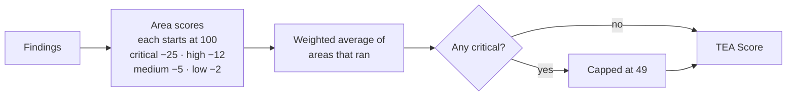

| Score | Verdict |
|---|---|
| 90–100 | ☕ Piping hot |
| 75–89 | 🍵 A good brew |
| 50–74 | 🫖 Lukewarm |
| 0–49 | 💦 Spilled |

Areas that didn't run show "not run yet" and don't count. The full set of sub-scores (features, security, performance, accessibility, code health, Prod Ready, UI wiring, DB scale) arrives with the steps that measure them.

## 🔍 How it works

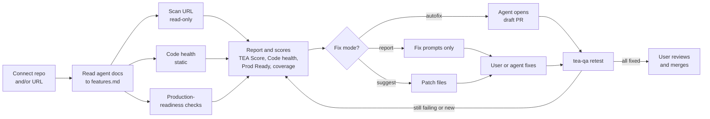

<details>
<summary><b>Code map</b> (one package, one folder per part under <code>src/</code>)</summary>

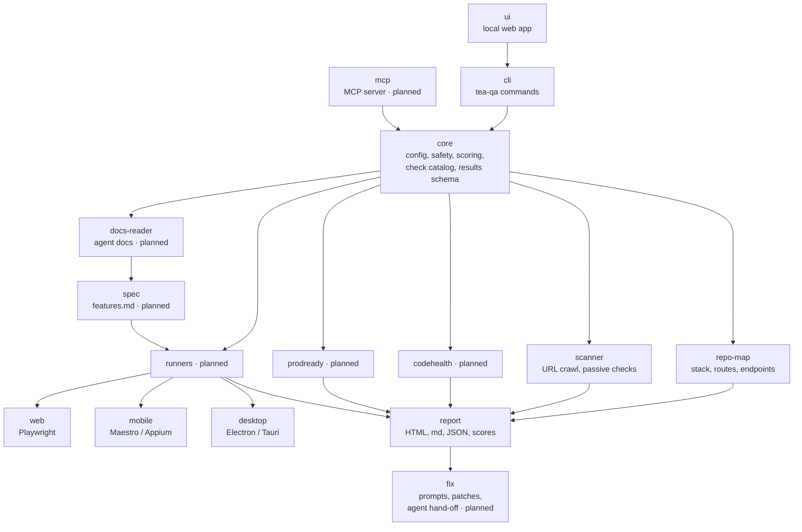

</details>

<details>
<summary><b>What happens during a run</b></summary>

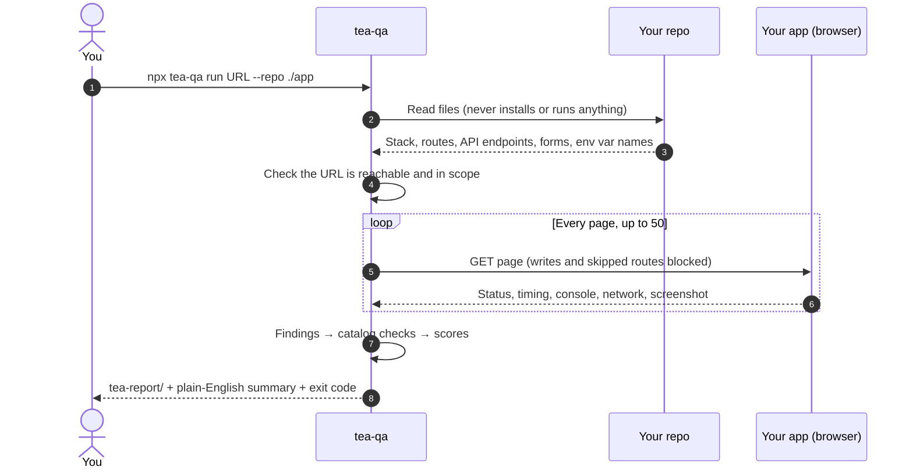

</details>

## 📜 features.md: claimed vs reality

*Planned (step 4).* TEA reads the docs your AI agents wrote **before** the code: `AGENTS.md`, `CLAUDE.md`, `GEMINI.md`, `.cursorrules`, `.cursor/rules/*`, `.windsurfrules`, `replit.md`, `.lovable/`, `.bolt/`, README, PRD/SPEC/TODO/CHANGELOG and `docs/`. It turns every claimed feature into a Given/When/Then check linked to its source line, and labels it *found in code*, *claimed but missing* or *built but undocumented*. You review it once (about 2 minutes); after that it is the source of truth.

```markdown
## CSV export
- Given a signed-in user with orders
- When they click "Export CSV" on /orders
- Then a CSV with one row per order downloads
- Source: CLAUDE.md:42 · Status: claimed but missing
```

Docs are untrusted data: TEA never follows instructions in them, and secrets found in docs are reported as leaked (and masked).

## 🛠️ Fix modes

*Planned (steps 8, 11, 12).* Set per repo in `tea.yaml`.

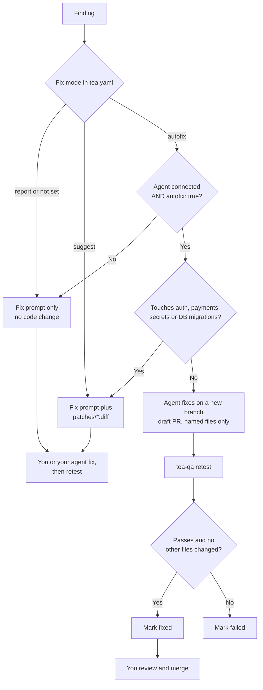

| Mode | What TEA does |
|---|---|
| `report` (default) | Report, scores and copy-paste fix prompts. Changes no code. |
| `suggest` | Everything in `report`, plus patch files in `tea-report/patches/*.diff` for you to apply. |
| `autofix` | Hands each finding to a connected agent (Claude, Cursor, GitLab Duo or any MCP client), which opens a **draft PR** touching only the files the finding names. TEA retests and marks it fixed or failed. |

TEA never merges and never pushes to main. Findings that touch auth, payments, secrets or database migrations always stay suggest-only.

## 🧩 Checks are data

Every check is a catalog entry, not hard-coded logic, so checks can be added, ranked and updated without a TEA upgrade.

```yaml
# checks/functional/crawl.server-error.yaml
id: crawl.server-error
title: Page crashes with a server error (5xx)
category: functional
severity: high
detect: crawl
rule: scanner:crawl.server-error
fix_prompt: prompts/crawl/server-error.md   # template with {file}, {route}, {evidence}
suggest_only: false
pack: free
version: 1
```

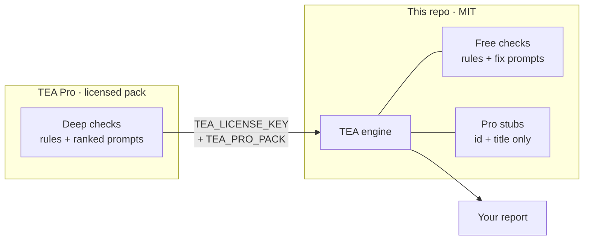

All **free** checks live here with their rules and prompts, and anyone can contribute new ones ([how](CONTRIBUTING.md#adding-a-check)). **TEA Pro** adds deeper checks (multi-role IDOR probes, race conditions, Supabase RLS correctness, Stripe edge cases, database-at-scale proofs, AI cost and abuse). In this repo they exist only as stubs with an id and a title, so a free report can tell you what a deeper check would cover. The loader refuses any pro rule written into the public catalog.

## 🌍 Works with any stack

A generic core works on any live URL and any repo. Stack knowledge lives in plugins that switch on automatically when TEA detects the stack.

| | Detected today |
|---|---|
| **Frameworks** | Next.js (app and pages router), React + Vite, Vue, Nuxt, Svelte, SvelteKit, Astro, Remix / React Router 7, Angular |
| **Backends** | Express, NestJS, Fastify, Hono, FastAPI, Flask, Django, Rails |
| **Data and auth** | Supabase, Firebase, Prisma, Drizzle, MongoDB, Postgres, Convex, NextAuth, Clerk, Auth0, Better Auth |
| **Payments** | Stripe, RevenueCat, Lemon Squeezy, Paddle |
| **Mobile** | Expo, React Native, Capacitor, Flutter (runners planned) |
| **Built with** | Lovable, Bolt, v0, Replit, Cursor, Windsurf, Claude Code |

Unknown stack? TEA still crawls the live site, and falls back to the links it finds in your source.

## ⚙️ tea.yaml (optional)

TEA needs no config. Add a `tea.yaml` only to change the defaults (full example: [`tea.example.yaml`](tea.example.yaml)).

```yaml
urls:
  - https://staging.your-app.com
skip:
  - /admin/**
  - /logout
allowlist:
  - api.your-app.com
accounts:
  - role: user
    email: tea-user@your-app.com
    password: ${TEA_USER_PASSWORD}   # read from the environment, masked everywhere
crawl:
  maxPages: 100
  slowPageMs: 3000
failOn: high
```

> [!TIP]
> A `tea.yaml` that TEA finds by itself inside the folder it's testing is treated as untrusted. Only its skip list, accounts and *lower* limits apply. Pass it with `--config tea.yaml` (or add `--trust-repo-config`) when it's yours. `${NAME}` works only in account fields, and only for `TEA_*` variables.

<details>
<summary><b>All options</b></summary>

```text
npx tea-qa run [url-or-folder] [options]

  --url <url>               URL of the running app to test
  --repo <path>             folder with the app source code
  -o, --out <dir>           where to write the report (default: tea-report)
  -c, --config <file>       tea.yaml to use (trusted)
  --max-pages <n>           most pages to visit (default: 50)
  --fail-on <severity>      exit 1 at this severity or worse: critical (default), high, medium, low, none
  --skip <glob>             route to never visit, e.g. "/admin/**" (repeatable)
  --allow <host>            extra host TEA may visit (repeatable)
  --login <email:password>  test account to use (masked everywhere)
  --start / --no-start      code-only: start the app without asking / never start it
  --trust-repo-config       trust a tea.yaml found in the tested folder (urls, allowlist, plugins)
  --no-ai                   rules only, no LLM calls
  --no-screenshots          do not save page screenshots
  --dry-run                 show the plan and estimated cost without doing anything
  -v, --verbose / -q, --quiet
```

`tea` is a short alias for `tea-qa`. `tea-qa ui [--port 4747] [--no-open]` opens the local web UI. Planned commands: `tea-qa retest`, `tea-qa mcp`, and `tea-qa run --targets targets.yaml` for many apps at once.

</details>

## 🛡️ Responsible use

**Only test apps you own or are authorised to test.** TEA shows this notice the first time it runs.

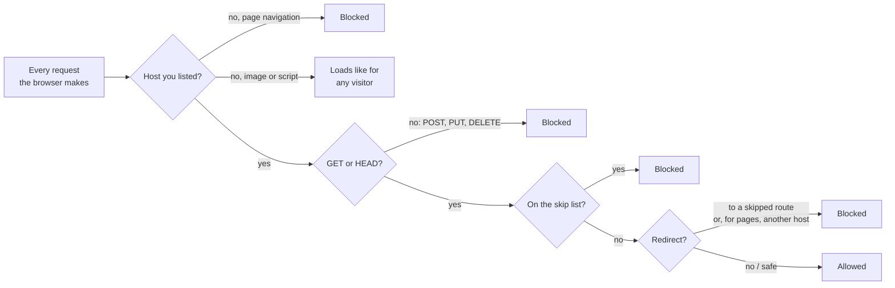

- **Read-only against live URLs.** TEA opens pages and never submits forms, logs in or sends write requests, even from your page's own scripts. Forms, logins and writes will only run in a sandbox you set up (step 10).
- **No load tests, active scans or fuzzing against production.**
- **Your repo is untrusted input.** TEA never runs `npm install` (install scripts are how supply-chain malware gets in), asks before starting your app, refuses dev scripts that look like they download or evaluate code, and ignores plugins and targets from a `tea.yaml` it wasn't given.
- **Docs and page content never change what TEA does.**
- **Secrets are masked everywhere:** the terminal, the report and every JSON file. TEA records env var *names*, never values.
- **Cost guard.** `--dry-run` shows the plan and estimated cost first. This version makes no LLM calls, so it costs $0.

> [!WARNING]
> **Badge disclaimer:** The TEA checked badge is not a security guarantee, audit or certification. It only shows the score from TEA's automated tests at the date of the last run.

## 🗺️ Roadmap

```mermaid
flowchart LR
    S1[1 Skeleton<br/>and hygiene]:::doing --> S2[2 Buggy<br/>example app]:::part --> S3[3 URL scan]:::part --> S4[4 Docs reader<br/>features.md] --> S5[5 Code health]
    S5 --> S6[6 Prod<br/>readiness] --> S7[7 Report<br/>and score]:::part --> S8[8 Fix prompts] --> S9[9 Retest] --> S10[10 AI functional<br/>tester]
    S10 --> S11[11 MCP server] --> S12[12 GitHub Action<br/>GitLab CI] --> S13[13 Mobile and<br/>desktop runners] --> S14[14 AI design<br/>review]
    classDef doing fill:#e8a33d,stroke:#b5651d,color:#2b1d12
    classDef part fill:#f6dfb5,stroke:#b5651d,color:#2b1d12
```

<sub>🟧 in progress · 🟨 partly built · ⬜ planned. Live status: [BUILD-PROGRESS.md](BUILD-PROGRESS.md).</sub>

| Step | What it adds |
|---|---|
| 3 · URL scan | Security headers, cookies, HTTPS/TLS, secrets in JS bundles and source maps, exposed endpoints, Supabase/Firebase client config, Lighthouse and axe |
| 4 · Docs reader | `features.md`: claimed vs reality from your agent docs |
| 5 · Code health | Duplication, circular imports, dead code, complexity, committed `.env`, leftover `console.log`, mock data in production → `CODE-HEALTH.md` |
| 6 · Prod readiness | Auth on every route, rate limits, input validation, CORS, CSP/HSTS, error handling, health checks, migrations, indexes, Stripe webhook signatures, privacy/terms, account deletion → **Prod Ready** score |
| 8–9 · Fix + retest | `FIXES.md`, one `FIX-PROMPT.md` per finding, patch files, and before/after scores |
| 10 · AI tester | Generated Playwright tests per feature in a sandbox: happy path, edge cases, IDOR between two test accounts, persistence; saved to `tea-tests/` |
| 11–12 · MCP + CI | `tea-qa mcp` for Claude Code, Cursor, Windsurf, Copilot and Codex; a GitHub Action that comments "☕ TEA Report" on PRs and runs nightly |
| 13–14 | Mobile (Expo/React Native) and desktop (Electron/Tauri) runners with app-store readiness; AI design review |

Every LLM step will be optional and pluggable (OpenAI, Anthropic, Gemini, or local Ollama for $0).

## 🔌 Writing a plugin

A plugin adds knowledge about one stack, and switches on when that stack is detected:

```ts
import { definePlugin } from 'tea-qa';

export default definePlugin({
  name: 'my-framework',
  activatesOn: ['my-framework'], // or a detect(ctx) function
  async discover(ctx) {
    const routes = ctx.find((f) => f.startsWith('routes/')).map((file) => ({
      path: '/' + file.slice('routes/'.length).replace(/\.ts$/, ''),
      kind: 'page' as const, file, dynamic: false, source: 'code' as const,
    }));
    return { routes };
  },
});
```

List it under `plugins:` in a `tea.yaml` you pass with `--config`.

## 🤝 Contributing

New checks, stack plugins and better fix prompts are the most useful contributions. Start with [CONTRIBUTING.md](CONTRIBUTING.md) and the [code of conduct](CODE_OF_CONDUCT.md). Found a security problem? Please report it privately; see [SECURITY.md](SECURITY.md).

## 📄 License

[MIT](LICENSE). The engine and all free checks are free forever.

<p align="center"><sub>☕ Made for everyone who shipped something with AI and wants to know if it really works.</sub></p>
