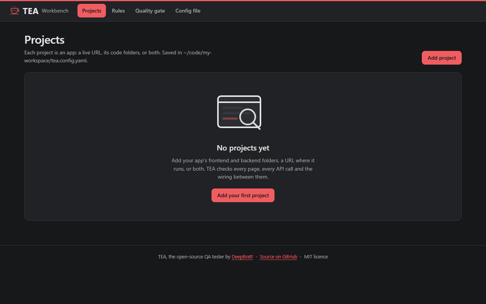
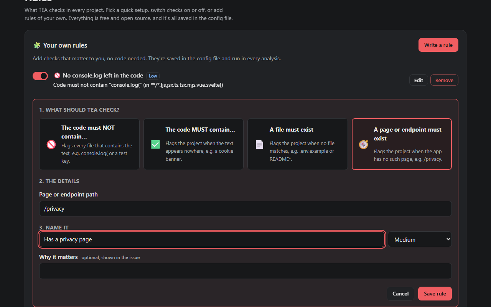
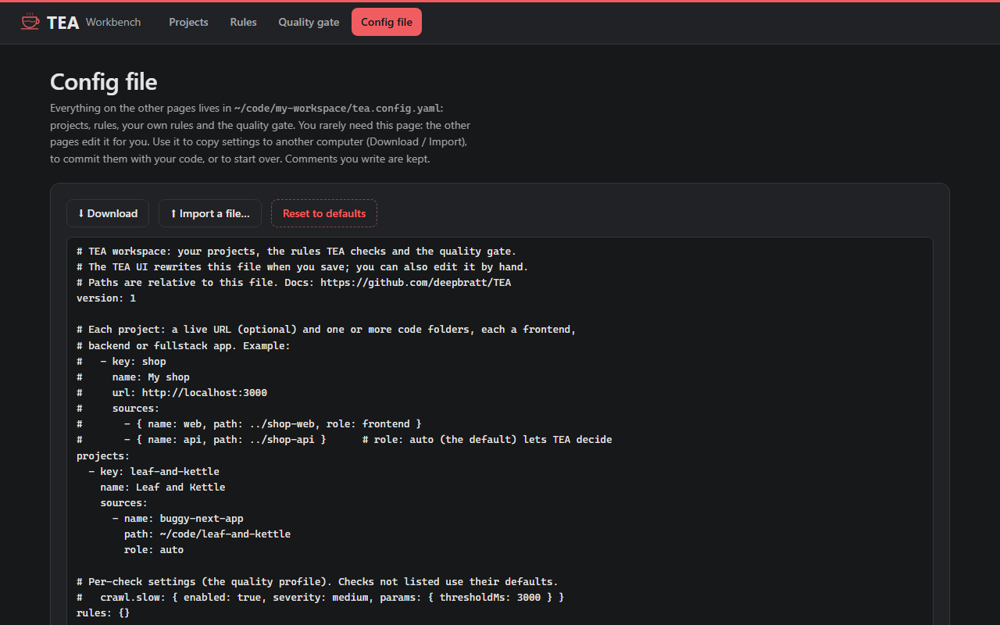

# Using TEA

The step-by-step guide, every setting in the config file, the command line, and CI. New here? Start with the [README](../README.md); to see it without installing anything, try the [live demo](https://deepbratt.github.io/TEA/demo/).

## 🧭 How to use it, step by step

<table>
<tr>
<td width="50%" valign="top">

**1. Start TEA.** Run `npm start`. The Workbench opens in your browser with an empty project list.



</td>
<td width="50%" valign="top">

**2. Add your app.** Click **Add project → Choose folder and detect** and pick your app's folder. TEA shows what it found in each part (the chips) and suggests the local URL. To test the running app, start it as usual and click its address.


</td>
</tr>
<tr>
<td valign="top">

**3. Run an analysis.** Press **Run analysis** on the project page. You get:
- the quality gate (Passed or Failed);
- the TEA Score;
- the issue counts and area scores;
- the full report, ready to share.


</td>
<td valign="top">

**4. Fix the issues.** Filter by severity, area or check. Open **Details** to see how to reproduce it, then **Copy fix prompt** and paste it into Cursor, Claude, Lovable or Bolt. Run the analysis again to confirm the fix.


</td>
</tr>
<tr>
<td valign="top">

**5. Tune the rules.** On **Rules**:
- pick **Relaxed**, **Balanced** or **Strict**;
- switch checks off that don't apply to you;
- change how serious they are.

Then press **Save rules**. *Coming soon* checks are listed so you can see what's next.


</td>
<td valign="top">

**6. Add your own rules.** Click an idea to add it, or **Write a rule**:
1. choose what to check;
2. fill in the details;
3. name it.

Your rules run in every analysis and show up as issues like any other check.



</td>
</tr>
<tr>
<td valign="top">

**7. Set the quality gate.** Pick a preset, or add conditions such as "high issues greater than 0". Every analysis is marked Passed or Failed against it, in the Workbench and in CI.


</td>
<td valign="top">

**8. Keep or share your settings.** Everything is in one file. On **Config file** you can:
- **download** it, or **import** one on another computer;
- commit it with your code;
- **reset** to the defaults.



</td>
</tr>
</table>

<sub>Screenshots are generated from the bundled example app by `node scripts/screenshots.mjs`.</sub>

## ⚙️ Configuration guide

You never have to edit a file: every setting has a page in the Workbench. If you like files, everything lives in one, **`tea.config.yaml`**. It sits next to where you ran `npm start` or `tea-qa ui`, or wherever `--workspace <file>` points. Edit it in your editor or on the **Config file** page, and commit it with your code. Every save is checked first, and your comments are kept.

```yaml
version: 1

projects:
  - key: shop                         # short id, used in URLs and `tea-qa run --project shop`
    name: My shop
    url: http://localhost:3000        # optional: where the app runs, to test it live
    maxPages: 50                      # optional: most pages to visit
    skip: [/admin/**, /logout]        # optional: paths never to visit
    sources:                          # up to 10 code folders, relative to this file
      - { name: web, path: ../shop-web, role: frontend }
      - { name: api, path: ../shop-api }   # role: auto (the default) lets TEA decide

rules:                                # only what differs from the defaults
  crawl.slow: { severity: high, params: { thresholdMs: 2000 } }
  wiring.unused-endpoint: { enabled: false }

customRules:                          # your own rules, no code
  - { id: no-console-log, title: No console.log in the code, type: forbid-text, text: "console.log(", files: "src/**/*.ts", severity: low }
  - { id: privacy-page, title: Has a privacy page, type: require-route, path: /privacy, severity: medium }
  - { id: env-example, title: Has a .env.example, type: require-file, files: "**/.env.example", severity: low }

gate:                                 # the gate fails when ANY condition is met
  conditions:
    - { metric: critical, op: gt, value: 0 }
    - { metric: high, op: gt, value: 3 }
    - { metric: score, op: lt, value: 60 }
```

<details>
<summary><b>Every setting, explained</b></summary>

**Projects**

| Field | What it does |
|---|---|
| `key` | Short id: lowercase letters, numbers and dashes. |
| `name` | What the Workbench shows. |
| `url` | Optional. Where the app runs, so TEA can open it in a browser (read-only). Without it, TEA reads the code only. |
| `sources` | The code folders. `path` is relative to the config file. `role` is `auto` (default), `frontend`, `backend` or `fullstack`. |
| `maxPages`, `skip` | Optional limits for the live crawl. |
| `gate` | Optional. A gate for this project only, replacing the shared one. |

**Rules** (`rules:`): one entry per check id, listing only what you change.

| Field | What it does |
|---|---|
| `enabled: false` | Turns the check off. |
| `severity` | `critical`, `high`, `medium`, `low` or `info` (a tip, never an issue). |
| `params` | Check settings, e.g. `crawl.slow: { params: { thresholdMs: 2000 } }`. |

**Your own rules** (`customRules:`)

| `type` | Fields | Flags |
|---|---|---|
| `forbid-text` | `text`, optional `regex: true`, optional `files` glob | Every file that contains the text |
| `require-text` | `text`, optional `regex: true`, optional `files` glob | The project, when the text appears nowhere |
| `require-file` | `files`: a file name or glob, e.g. `README*` | The project, when no file matches |
| `require-route` | `path`: e.g. `/privacy`, globs allowed | The project, when no page or endpoint matches |

Every custom rule also has an `id`, a `title`, a `severity`, an optional `description` (shown in the issue) and `enabled`.

**Quality gate** (`gate.conditions`): each condition is `metric`, `op` (`gt` greater than, `lt` less than) and `value`.

| `metric` | Means |
|---|---|
| `score` | The TEA Score, 0 to 100 |
| `issues` | All issues (tips not counted) |
| `critical`, `high`, `medium`, `low` | Issues of that severity |
| `functional`, `api`, `security`, `performance`, `accessibility`, `load`, `code` | That area's score, 0 to 100. Areas that didn't run never fail the gate |

**Environment variables**

| Variable | What it does |
|---|---|
| `TEA_WORKSPACE` | The config file `npm run ui:dev` uses. |
| `TEA_CHECKS` | Extra folders of check entries (community packs), separated like `PATH`. |

`tea.config.yaml` holds your projects and how they're judged. The optional per-repo [`tea.yaml`](#%EF%B8%8F-teayaml-optional) holds crawl settings for the command line (URLs, allowlist, test accounts).

</details>

Run the same project from the command line or CI, with its rules, your rules and its gate:

```bash
npx tea-qa run --project shop                    # uses ./tea.config.yaml
npx tea-qa run --source ../web --source ../api   # no config file; roles auto-detected
```

## ⚙️ tea.yaml (optional)

TEA needs no config. Add a `tea.yaml` only to change the defaults (full example: [`tea.example.yaml`](../tea.example.yaml)).

```yaml
urls:
  - https://staging.your-app.com
skip:
  - /admin/**
  - /logout
allowlist:
  - api.your-app.com
accounts:
  - role: user
    email: tea-user@your-app.com
    password: ${TEA_USER_PASSWORD}   # read from the environment, masked everywhere
crawl:
  maxPages: 100
  slowPageMs: 3000
failOn: high
```

> [!TIP]
> A `tea.yaml` that TEA finds by itself inside the folder it's testing is treated as untrusted. Only its skip list, accounts and *lower* limits apply. Pass it with `--config tea.yaml` (or add `--trust-repo-config`) when it's yours. `${NAME}` works only in account fields, and only for `TEA_*` variables.

<details>
<summary><b>All options</b></summary>

```text
npx tea-qa run [url-or-folder] [options]

  --url <url>               URL of the running app to test
  --repo <path>             folder with the app source code
  --source <[role=]path>    a code folder; repeat for a separate frontend and backend (role auto-detected, or frontend=, backend=, fullstack=)
  --project <key>           run a project from tea.config.yaml, with its rules and quality gate (exit 1 if the gate fails)
  -w, --workspace <file>    the config file for --project (default: tea.config.yaml)
  -o, --out <dir>           where to write the report (default: tea-report)
  -c, --config <file>       tea.yaml to use (trusted)
  --max-pages <n>           most pages to visit (default: 50)
  --fail-on <severity>      exit 1 at this severity or worse: critical (default), high, medium, low, none
  --skip <glob>             route to never visit, e.g. "/admin/**" (repeatable)
  --allow <host>            extra host TEA may visit (repeatable)
  --login <email:password>  test account to use (masked everywhere)
  --start / --no-start      code-only: start the app without asking / never start it
  --trust-repo-config       trust a tea.yaml found in the tested folder (urls, allowlist, plugins)
  --no-ai                   rules only, no LLM calls
  --no-screenshots          do not save page screenshots
  --dry-run                 show the plan and estimated cost without doing anything
  -v, --verbose / -q, --quiet
```

`tea` is a short alias for `tea-qa`. `tea-qa ui [--workspace tea.config.yaml] [--port 4747] [--no-open]` opens the TEA Workbench. Planned commands: `tea-qa retest`, `tea-qa mcp`, and `tea-qa run --targets targets.yaml` for many apps at once.

</details>

## 🚦 Use it in CI

Commit `tea.config.yaml`, then fail the build when the quality gate fails:

```yaml
# .github/workflows/tea.yml
name: TEA
on: [pull_request]
jobs:
  tea:
    runs-on: ubuntu-latest
    steps:
      - uses: actions/checkout@v4
      - uses: actions/setup-node@v4
        with: { node-version: 22 }
      - run: git clone --depth 1 https://github.com/deepbratt/TEA.git ../tea && cd ../tea && npm ci && npm run build && npx playwright install --with-deps chromium
      - run: node ../tea/dist/cli/bin.js run --project my-app   # exits 1 when the gate fails
      - uses: actions/upload-artifact@v4
        if: always()
        with: { name: tea-report, path: tea-report }
```

A ready-made GitHub Action that comments "☕ TEA Report" on pull requests is planned (step 12).

---

TEA is created and maintained by [DeepBratt](https://github.com/deepbratt). [How TEA works](HOW-IT-WORKS.md) · [Website](https://deepbratt.github.io/TEA/)

