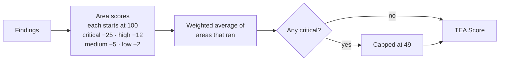
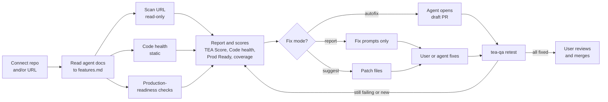
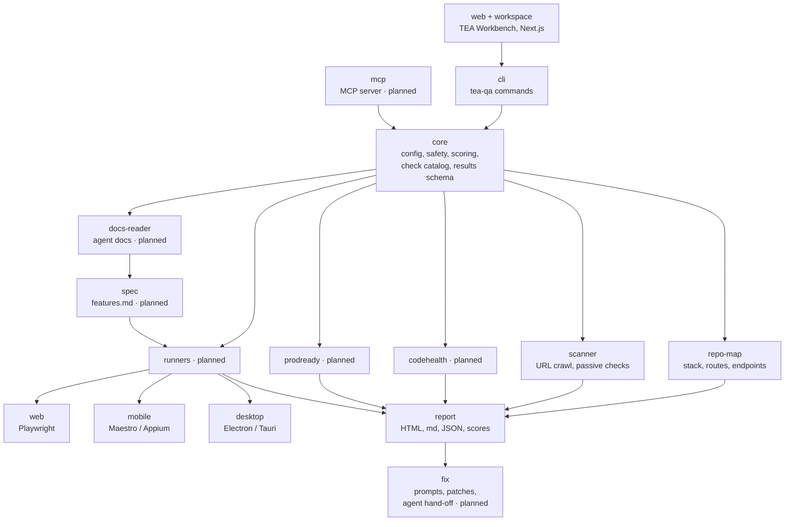
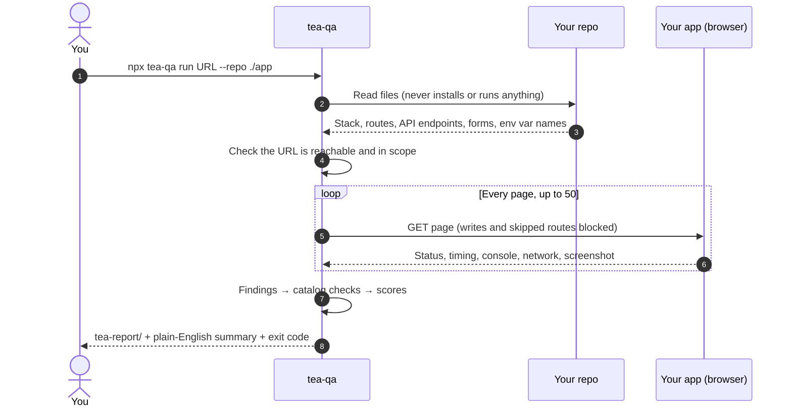
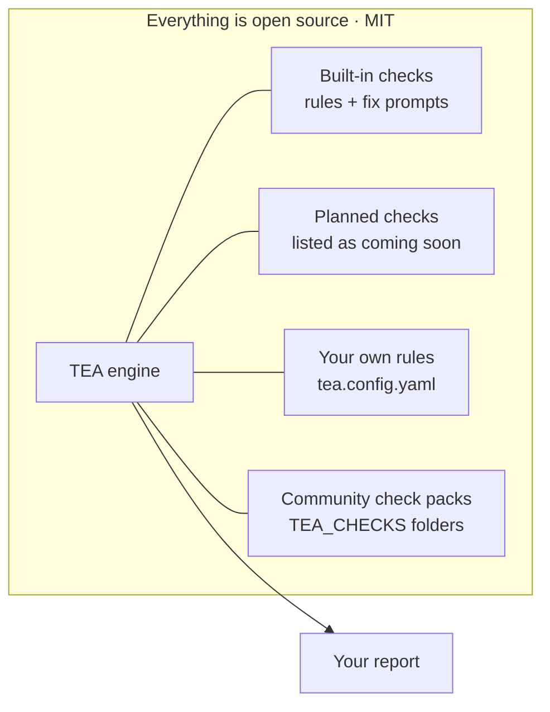
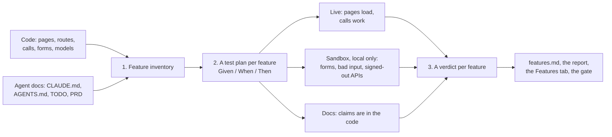
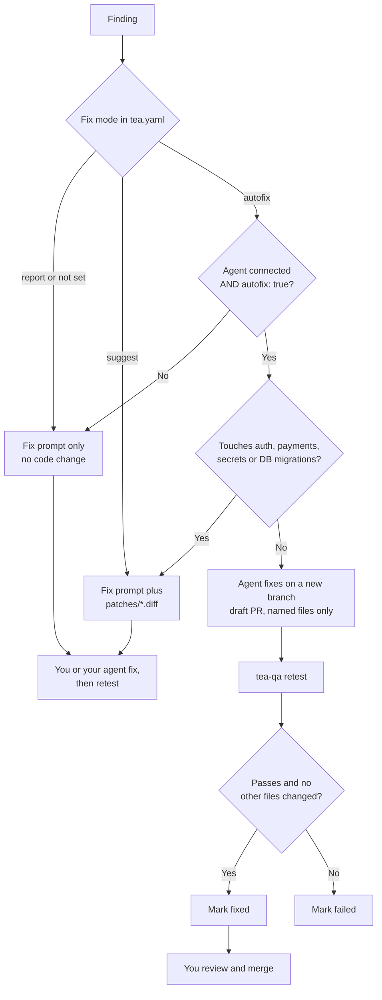
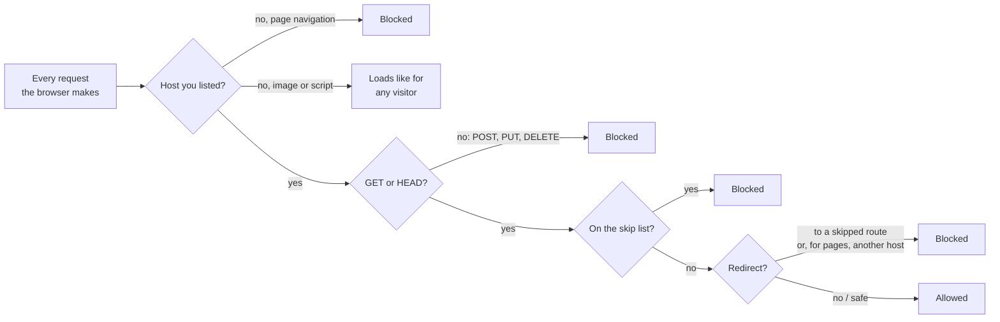

# How TEA works

What TEA checks and how: the report and the TEA Score, the pipeline, the check catalog, every supported stack, safety, the roadmap and plugins. To use TEA, see the [guide](GUIDE.md).

## ☕ What you get

<table>
<tr>
<td width="55%" valign="top">

```text
Here's the TEA on your app: 68/100 (Lukewarm).
TEA opened 10 pages in your running app and read
your code (Next.js, React). It found 8 issues:
2 high, 4 medium, 2 low.

Top issues:
 1. [high] API call fails on /pricing:
    GET /api/plans (500)  app/api/plans/route.ts
 2. [high] Page crashes with a server error
    (500): /account  app/account/page.tsx
 3. [medium] JavaScript crashes on /about
 4. [medium] Broken link to /blog
 5. [medium] Broken link to /terms
```

A real run against [`examples/buggy-next-app`](../examples/buggy-next-app), a made-up tea shop full of seeded bugs (`npm run demo` reproduces it). Issue 1 is the classic launch bug: the pricing page loads, but shows no plans, so nobody can pay.

</td>
<td width="45%" valign="top">

<sub>A sample score card (shareable PNG export is planned).</sub>
</td>
</tr>
</table>

Every finding comes with a severity, evidence (a screenshot or URL), the likely `file:line`, steps to reproduce, and a **fix prompt** you can paste into Cursor, Claude or Lovable. Anything TEA observed on your site is quoted inside an `UNTRUSTED EVIDENCE` block, so your agent never follows instructions hidden in page text.

| In `tea-report/` | What it is |
|---|---|
| `report.html` | The report: TEA Score, area scores, top fixes with screenshots and copy-paste fix prompts, feature map |
| `report.md` | The same report in Markdown, for PRs and issues |
| `results.json` | Machine-readable results |
| `features.md` · `features.json` | Every feature, its Given / When / Then test plan and its verdict ([more below](#-feature-by-feature-featuresmd)) |
| `app-map.json` · `feature-map.md` | Your stack, pages, API endpoints, forms, auth, payments and env var *names*, plus what's live, what's broken and what nothing links to |
| `screenshots/` | A full-page screenshot of every page TEA visited |

### The TEA Score



| Score | Verdict |
|---|---|
| 90–100 | ☕ Piping hot |
| 75–89 | 🍵 A good brew |
| 50–74 | 🫖 Lukewarm |
| 0–49 | 💦 Spilled |

Areas that didn't run show "not run yet" and don't count. The full set of sub-scores (features, security, performance, accessibility, code health, Prod Ready, UI wiring, DB scale) arrives with the steps that measure them.

## 🔍 How it works



<details>
<summary><b>Code map</b> (one package, one folder per part under <code>src/</code>)</summary>



</details>

<details>
<summary><b>What happens during a run</b></summary>



</details>

## 🌍 Works with any stack

A generic core works on any live URL and any repo, in any language. TEA reads each ecosystem's manifest (`package.json`, `requirements.txt`, `pyproject.toml`, `Pipfile`, `go.mod`, `Cargo.toml`, `pom.xml`, `build.gradle`, `*.csproj`, `composer.json`, `Gemfile`, `mix.exs`, `pubspec.yaml`, `Package.swift`). Stack knowledge lives in plugins that switch on automatically when TEA detects the stack.

| | Detected today | Routes and endpoints read from code |
|---|---|---|
| **JavaScript / TypeScript** | Next.js, Remix / React Router 7, Nuxt, SvelteKit, Astro, Angular, React, Vue, Svelte, Solid, Qwik, Preact, Gatsby, Ember, htmx, Vite | Express, NestJS, Fastify, Hono, Koa, Elysia, plus every meta-framework |
| **Python** | FastAPI, Flask, Django, Starlette, Sanic, Litestar, Quart | ✓ |
| **Go** | net/http, Gin, Echo, Fiber, chi, Gorilla mux | ✓ (route groups too) |
| **Rust** | Axum, Actix Web, Rocket | ✓ |
| **Java / Kotlin** | Spring Boot, JAX-RS / Quarkus, Micronaut, Ktor | ✓ |
| **C# / .NET** | ASP.NET Core (minimal APIs and controllers), Blazor | ✓ |
| **PHP** | Laravel, Symfony, Slim | ✓ |
| **Ruby, Elixir, Swift** | Rails, Sinatra, Phoenix, Vapor | ✓ |
| **Mobile and desktop** | Expo, React Native, Flutter, iOS (Swift), Android, Capacitor, Ionic, Electron, Tauri | API calls (runners planned) |
| **Data and auth** | Supabase, Firebase, Prisma, Drizzle, SQLAlchemy, GORM, Diesel / SeaORM / SQLx, Entity Framework, JPA, Ecto, MongoDB, Postgres, MySQL, SQLite, Redis, Convex, NextAuth, Clerk, Auth0, Better Auth, Devise | |
| **Payments** | Stripe, RevenueCat, Lemon Squeezy, Paddle | |
| **Built with** | Lovable, Bolt, v0, Replit, Cursor, Windsurf, Claude Code | |

**API calls in any client language** feed the frontend-to-API wiring checks: `fetch`/`axios`/`useSWR`/Angular `HttpClient` (JS/TS), `requests`/`httpx` (Python), `net/http` (Go), `reqwest` (Rust), Retrofit/OkHttp/Ktor client/RestTemplate (JVM), `HttpClient` (C#), Laravel `Http`/Guzzle (PHP), Faraday/HTTParty (Ruby), `http`/Dio (Dart), `URLSession` (Swift). Calls to other hosts (Stripe, OpenAI…) are left out.

**Auto-detect.** Point TEA at a folder and it works out the rest:
- **One app or many.** A monorepo (npm/pnpm workspaces, Turborepo, Nx, `go.work`, or just `frontend/` + `backend/` folders) is split into its apps.
- **Frontend, backend or fullstack.** Each folder's role is decided from what's in it (`role: auto`, the default), so a React app and a Go API are wired together without any setup.
- **Where it runs.** TEA suggests the local URL from the app's own config or its framework's dev port, and checks which one is running right now.

Unknown stack? TEA still crawls the live site, and falls back to the links it finds in your source.

## 🧩 Checks are data

Every check is a catalog entry, not hard-coded logic, so checks can be added, ranked and updated without a TEA upgrade.

```yaml
# checks/functional/crawl.server-error.yaml
id: crawl.server-error
title: Page crashes with a server error (5xx)
description: "A page shows a server error (500) instead of its content."   # plain English, shown on the Rules page
category: functional
severity: high
detect: crawl
rule: scanner:crawl.server-error
fix_prompt: prompts/crawl/server-error.md   # template with {file}, {route}, {evidence}
suggest_only: false
version: 1
```



**Nothing is locked.** Every check ships in this repo, free and open source, and anyone can contribute new ones ([how](../CONTRIBUTING.md#adding-a-check)). Checks whose detector isn't built yet are listed on the Rules page as *Coming soon*: multi-role IDOR probes, race conditions, Supabase RLS correctness, Stripe edge cases, database-at-scale proofs, and AI cost and abuse. They need the sandbox tester from [step 10](#%EF%B8%8F-roadmap). Point `TEA_CHECKS` at extra folders (separated like `PATH`) to load community check packs in the same format.

## 📜 Feature by feature: features.md



**The inventory** (`src/features/inventory.ts`) groups what TEA found in the code into features named after their route: `/orders`, `/orders/[id]` and `/api/orders` are *Orders*; `/reset-password` and `/api/password-reset` are *Password reset*. A route's API calls and forms belong to the page whose folder they're in, and an API route without a page joins the one page that calls it (`/api/stats`, called only from the dashboard, is part of *Dashboard*). Data models and services (payments, auth) join the features they're named after.

**The docs check** (`src/features/docs.ts` and `claims.ts`) reads `CLAUDE.md`, `AGENTS.md`, `GEMINI.md`, `.cursorrules`, `.cursor/rules/*.mdc`, `.windsurfrules`, `.clinerules`, `.github/copilot-instructions.md`, README, TODO, ROADMAP, FEATURES, PRD, SPEC and REQUIREMENTS files (at the root or in `docs/`). Only list items under feature headings (*What's built*, *Features*, *Roadmap*…) and checklist items count; rules, setup and stack sections are skipped. TEA says a claim is missing only for a concrete reason:
- a path the docs name that no route serves (`/api/health`);
- a capability with no library and no code for it: CSV export, PDFs, sending email or SMS, rate limits, search, payments, AI, uploads, real-time, health checks. Comments don't count, so `// TODO: rate limit` is not a rate limit;
- a thing the UI calls but nothing serves (the wishlist, when `/api/wishlist` has no route).

Anything else is *unverified* (test it by hand), never failed. Planned items are *not built yet*, which is fine.

**The verdict** (`src/features/evaluate.ts`) is one of:
- *broken*: a page, call, form or API of the feature fails with a serious issue;
- *partly works*: smaller issues, or docs that claim more than is built;
- *works*: everything that ran passed, and at least one step ran live;
- *not tested yet*: nothing ran against it.

```markdown
## ⚠️ Dashboard: Partly works
| | Given | When | Then | Result |
|---|---|---|---|---|
| ✓ | a visitor who isn't signed in | they open /dashboard | the page loads without errors | Loaded (200) in 0.4s. |
| ✕ | CLAUDE.md says: "CSV export of orders: done." | TEA looks for it in the code | it's there | TEA found no code for CSV export |
```

**Sandbox tests** (`src/features/sandbox.ts`) are the only part of TEA that writes. They're off by default and refuse any URL that isn't on your computer. They also block writes to every other host, never fill card, bank, identity or file fields, and never press delete, cancel or sign-out buttons.

Docs are untrusted data: TEA never follows instructions in them. Their text reaches fix prompts only inside the labelled untrusted-evidence block.

## 🛠️ Fix modes

*Planned (steps 8, 11, 12).* Set per repo in `tea.yaml`.



| Mode | What TEA does |
|---|---|
| `report` (default) | Report, scores and copy-paste fix prompts. Changes no code. |
| `suggest` | Everything in `report`, plus patch files in `tea-report/patches/*.diff` for you to apply. |
| `autofix` | Hands each finding to a connected agent (Claude, Cursor, GitLab Duo or any MCP client), which opens a **draft PR** touching only the files the finding names. TEA retests and marks it fixed or failed. |

TEA never merges and never pushes to main. Findings that touch auth, payments, secrets or database migrations always stay suggest-only.

## 🛡️ Responsible use

**Only test apps you own or are authorised to test.** TEA shows this notice the first time it runs.



- **Read-only against live URLs.** TEA opens pages and never submits forms, logs in or sends write requests, even from your page's own scripts. Form submissions only run as sandbox tests, which you turn on, on an app running on your own computer.
- **No load tests, active scans or fuzzing against production.**
- **Your repo is untrusted input.** TEA never runs `npm install` (install scripts are how supply-chain malware gets in), asks before starting your app, refuses dev scripts that look like they download or evaluate code, and ignores plugins and targets from a `tea.yaml` it wasn't given.
- **Docs and page content never change what TEA does.**
- **Secrets are masked everywhere:** the terminal, the report and every JSON file. TEA records env var *names*, never values.
- **Cost guard.** `--dry-run` shows the plan and estimated cost first. This version makes no LLM calls, so it costs $0.

> [!WARNING]
> **Badge disclaimer:** The TEA checked badge is not a security guarantee, audit or certification. It only shows the score from TEA's automated tests at the date of the last run.

## 🗺️ Roadmap

```mermaid
flowchart LR
    S1[1 Skeleton<br/>and hygiene]:::doing --> S2[2 Buggy<br/>example app]:::part --> S3[3 URL scan]:::part --> S4[4 Docs reader<br/>features.md]:::part --> S5[5 Code health]
    S5 --> S6[6 Prod<br/>readiness] --> S7[7 Report<br/>and score]:::part --> S8[8 Fix prompts] --> S9[9 Retest] --> S10[10 Functional<br/>tester]:::part
    S10 --> S11[11 MCP server] --> S12[12 GitHub Action<br/>GitLab CI] --> S13[13 Mobile and<br/>desktop runners] --> S14[14 AI design<br/>review]
    classDef doing fill:#f05d61,stroke:#b3262c,color:#141517
    classDef part fill:#c9ccd1,stroke:#5c5f66,color:#141517
```



<sub>Red: in progress · grey: partly built · outlined: planned. Live status: [BUILD-PROGRESS.md](../BUILD-PROGRESS.md).</sub>

| Step | What it adds |
|---|---|
| 3 · URL scan | Security headers, cookies, HTTPS/TLS, secrets in JS bundles and source maps, exposed endpoints, Supabase/Firebase client config, Lighthouse and axe |
| 4 · Docs reader | `features.md`: claimed vs reality from your agent docs. **Built:** the feature inventory, the docs check, and a test plan and verdict per feature |
| 5 · Code health | Duplication, circular imports, dead code, complexity, committed `.env`, leftover `console.log`, mock data in production → `CODE-HEALTH.md` |
| 6 · Prod readiness | Auth on every route, rate limits, input validation, CORS, CSP/HSTS, error handling, health checks, migrations, indexes, Stripe webhook signatures, privacy/terms, account deletion → **Prod Ready** score |
| 8–9 · Fix + retest | `FIXES.md`, one `FIX-PROMPT.md` per finding, patch files, and before/after scores |
| 10 · Functional tester | Sandbox tests per feature. **Built:** forms with valid and invalid data, and signed-out API calls. **Next:** IDOR between two test accounts, persistence after a reload, saved Playwright tests in `tea-tests/`, and an optional AI explorer for complex flows |
| 11–12 · MCP + CI | `tea-qa mcp` for Claude Code, Cursor, Windsurf, Copilot and Codex; a GitHub Action that comments "☕ TEA Report" on PRs and runs nightly |
| 13–14 | Mobile (Expo/React Native) and desktop (Electron/Tauri) runners with app-store readiness; AI design review |

Every LLM step will be optional and pluggable (OpenAI, Anthropic, Gemini, or local Ollama for $0).

## 🔌 Writing a plugin

A plugin adds knowledge about one stack, and switches on when that stack is detected:

```ts
import { definePlugin } from 'tea-qa';

export default definePlugin({
  name: 'my-framework',
  activatesOn: ['my-framework'], // or a detect(ctx) function
  async discover(ctx) {
    const routes = ctx.find((f) => f.startsWith('routes/')).map((file) => ({
      path: '/' + file.slice('routes/'.length).replace(/\.ts$/, ''),
      kind: 'page' as const, file, dynamic: false, source: 'code' as const,
    }));
    return { routes };
  },
});
```

List it under `plugins:` in a `tea.yaml` you pass with `--config`.

---

TEA is created and maintained by [DeepBratt](https://github.com/deepbratt). [Using TEA](GUIDE.md) · [Website](https://deepbratt.github.io/TEA/)

